# XRay 3D Reconstruction System

A working browser reconstruction workbench inspired by the five supplied desktop reference images. Built with Three.js, Vite, Canvas and a CPU Web Worker. It includes real parallel-beam filtered backprojection, a synthetic bone-like phantom, projection import, segmentation, 3D inspection, measurements, and exports.

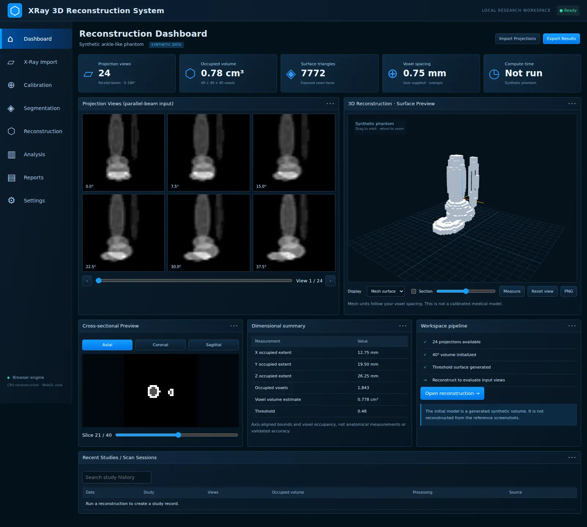

## Run

Node.js 22+ and npm:

```sh
npm ci
npm run dev
# Open the localhost URL printed by Vite.
```

```sh
npm test
npm run build
npm run preview
```

No backend, API key, or GPU compute service is required. Three.js needs WebGL for the 3D viewer. Slice tools and mesh export remain available if WebGL cannot start.

## Workflow

1. **Dashboard:** inspect the generated synthetic phantom, six projection previews, cross-sections and actual volume/surface statistics. The initial volume is generated directly, not reconstructed from the screenshot references.
2. **X-Ray Import:** choose/drop 6–90 PNG/JPEG/WebP projection images. Files are sorted by filename, resampled to the active detector grid, and assigned evenly spaced angles over 180°. Review/edit each angle. Import clears the previous volume until reconstruction succeeds.
3. **Calibration:** enter isotropic voxel spacing from the acquisition setup. All mesh coordinates, bounds and surface distances use this value. No automatic calibration is inferred.
4. **Segmentation:** inspect axial/coronal/sagittal slices; apply a global intensity threshold; compare original, threshold and edge previews. The threshold controls surface generation and voxel occupancy.
5. **Reconstruction:** run Ram-Lak filtered backprojection on current projections, or generate and reconstruct a synthetic phantom. Computation runs in a cancellable worker and retains the previous volume when cancelled. Synthetic sample grids: 24, 32, 40, 48 or 64; 6–90 angular views.
6. **3D inspection:** drag to orbit, wheel to zoom, switch mesh/points/wireframe, move a section plane, reset the camera, capture a PNG, or click two surface points in Measure mode. Point mode displays surface mesh samples, not independently reconstructed feature points.
7. **Analysis and Reports:** inspect axis-aligned occupied bounds, occupied voxel volume, surface triangle counts and actual compute time. Generate report metadata, export CSV/JSON, or use Print / Save as PDF.
8. **Export and Settings:** download the current voxel surface as STL/OBJ, or save/restore complete volume and projection data as JSON. Browse all five supplied design references.

## Algorithm and input assumptions

The synthetic sample uses overlapping ellipsoidal shells to suggest long bones and a hindfoot. Forward projection uses linear detector-bin splatting. Reconstruction convolves each detector row with a discrete Ram-Lak filter and applies angularly weighted, linearly interpolated parallel-beam backprojection, followed by nonnegative peak normalization. Mesh generation emits the exposed faces of thresholded voxels. The surface is intentionally a block-style voxel boundary, not a smoothed anatomical model.

Projection columns are detector positions. The top image row maps to the highest world Z; the bottom image row maps to the first axial slice (index 0). Angles rotate around Z and must be unique in [0°,180°). All views must share the same detector geometry and centered rotation axis. Imported intensities are treated as nonnegative line-integral values after grayscale conversion to [0,1]. Raw transmission images generally require acquisition-specific corrections and logarithmic conversion before import. This application does not perform those corrections or read acquisition metadata.

Raster inputs are 8-bit browser-decoded PNG/JPEG/WebP, up to 10 MB and 24 megapixels each. They are resampled to a square grid, so detector aspect ratio and axial scale must already be compatible. DICOM, TIFF, cone-beam geometry, CT Hounsfield calibration, automatic landmarks and clinical bone recognition are not implemented. Sparse/incompatible views can produce severe artifacts. No accuracy or clinical utility is claimed for imported images.

## Running application screenshots

These show the implemented app with synthetic/test data, captured by the browser checks.

### Reconstruction

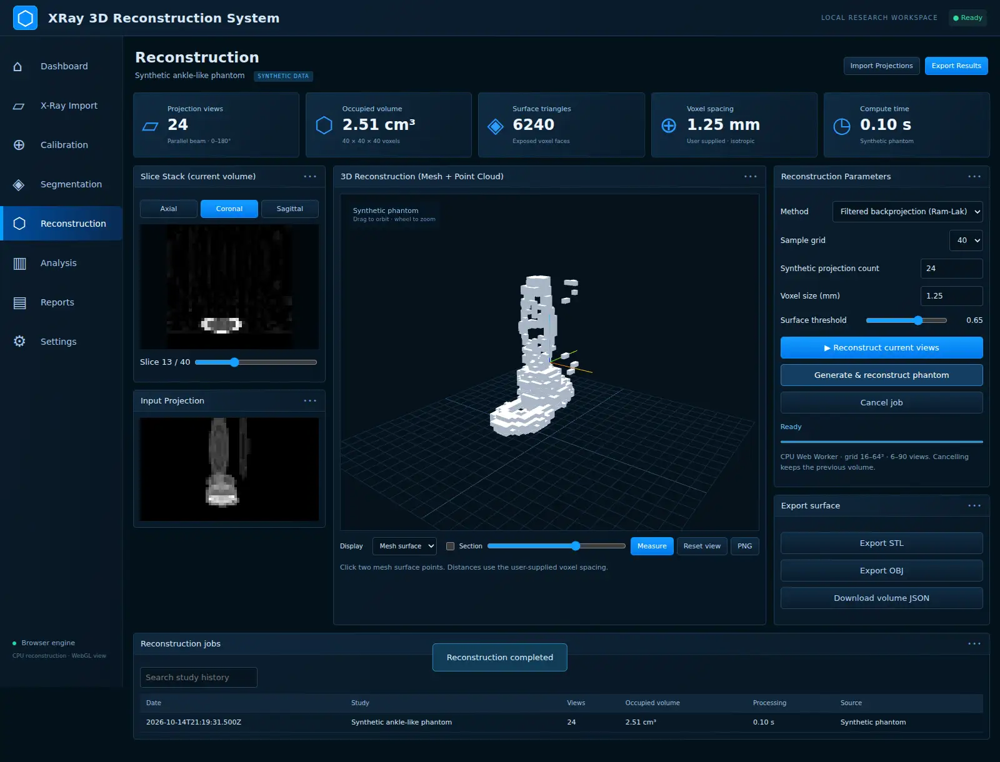

### Projection import

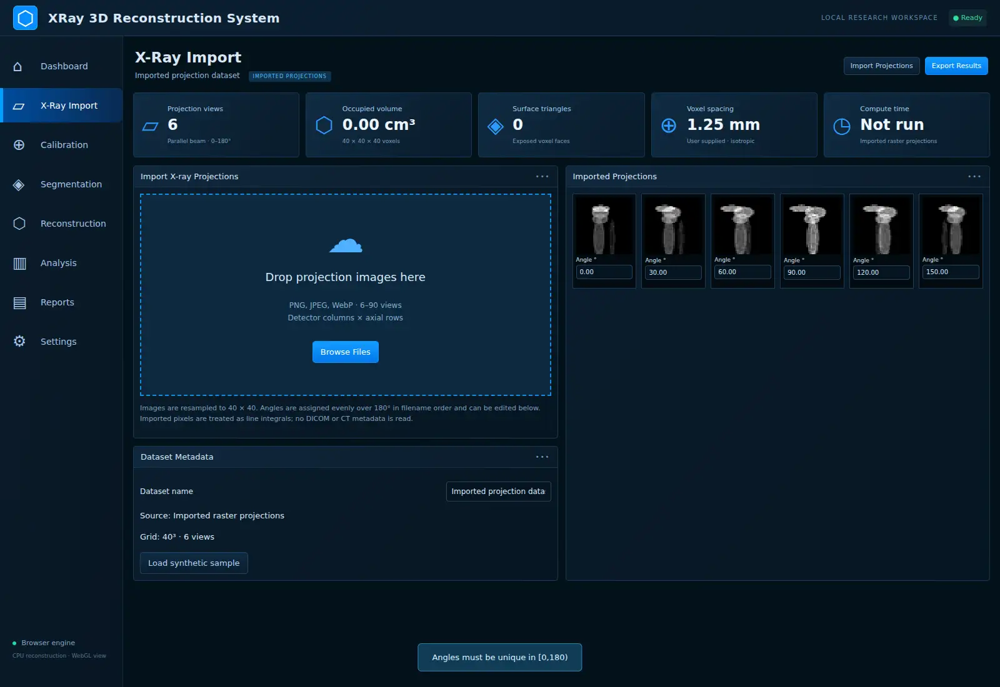

### Segmentation

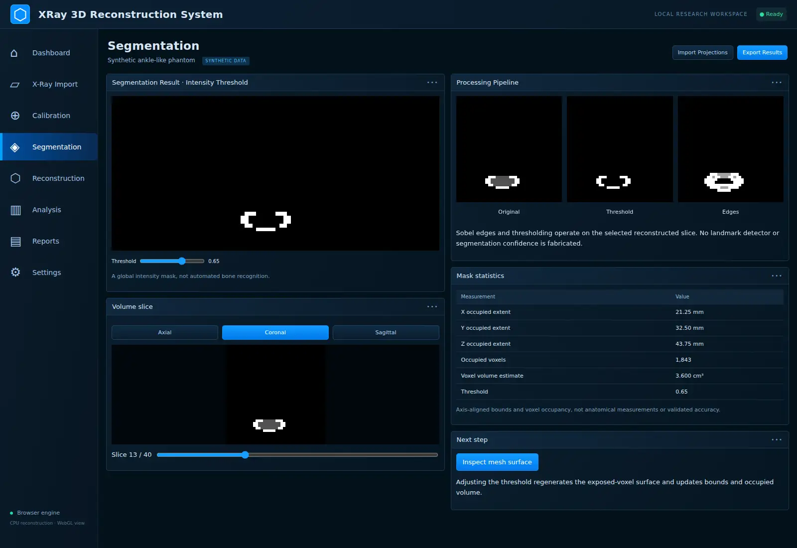

### Reports

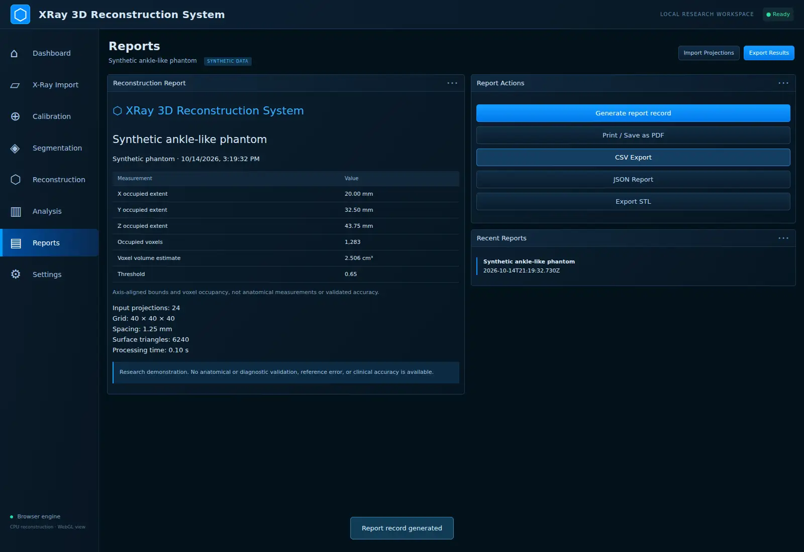

### Mobile layout

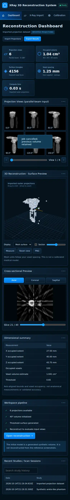

## Supplied design reference images

These are the user-provided visual targets, converted to WebP. Their anatomy, numerical quality scores, CUDA/OpenCV labels and clinical-looking results are illustrative reference content, not outputs from this implementation.

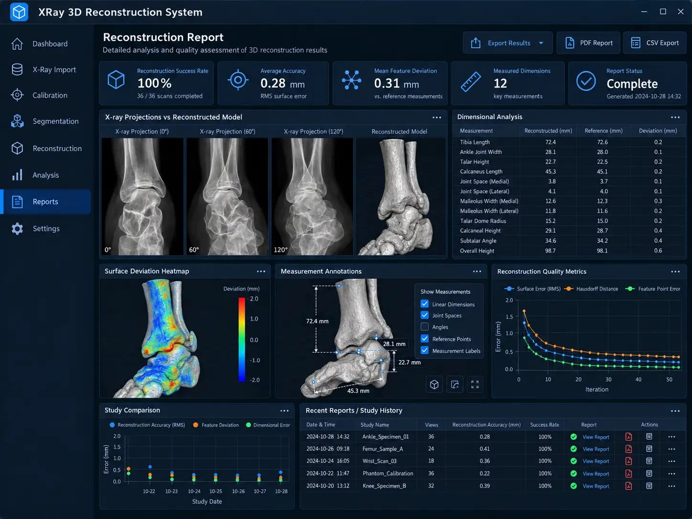
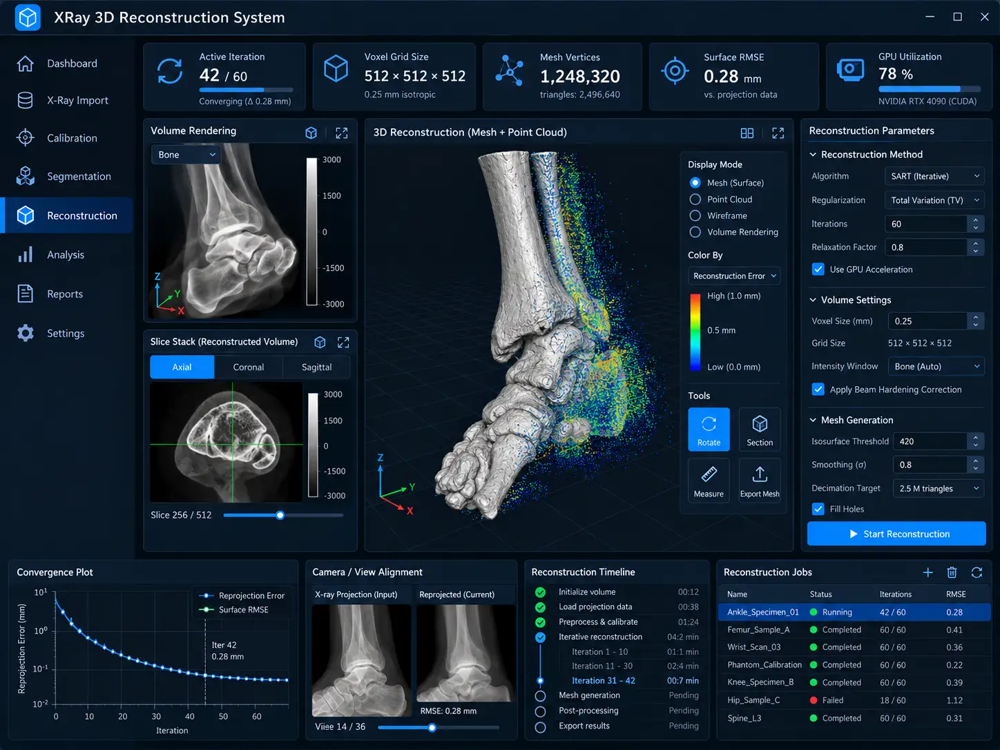
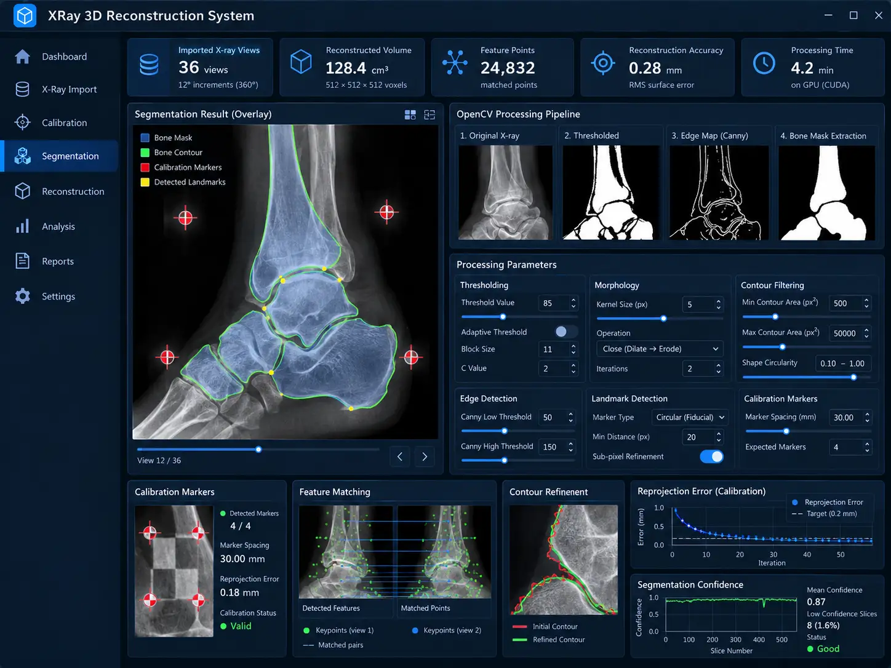
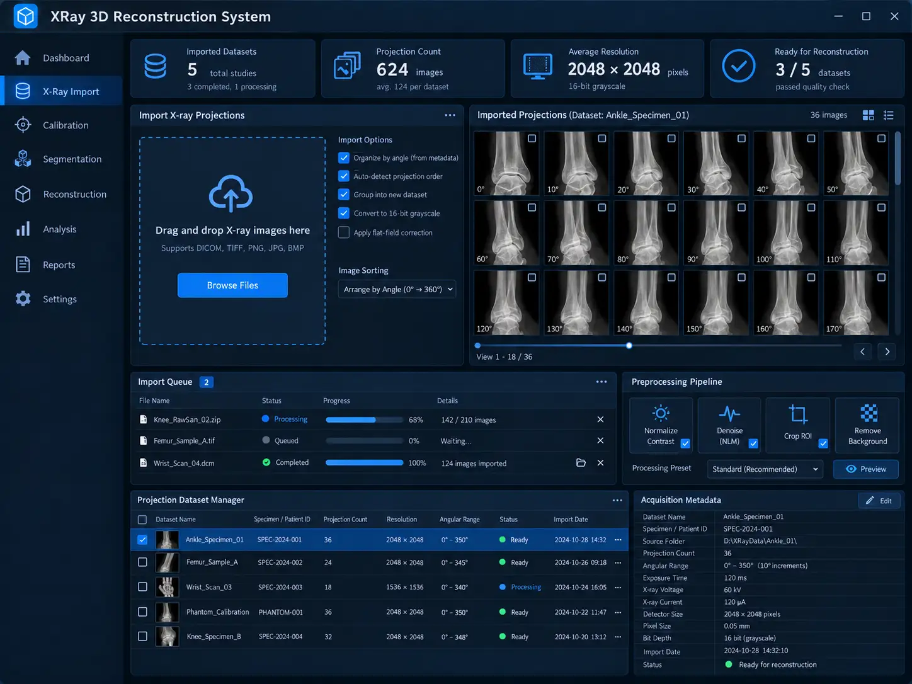
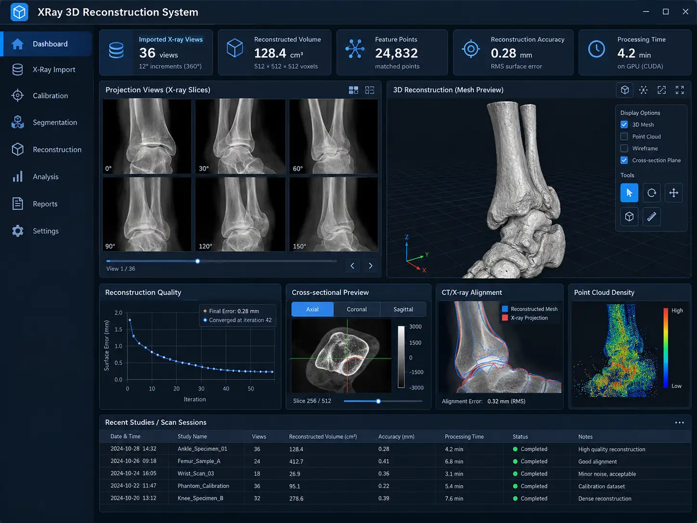

## Tests

Eight numerical tests verify signal conservation, synthetic reconstruction correlation, rejection of invalid input, slice orientations, outward triangle normals, suppression of internal voxel faces, mesh exports, and calibrated occupancy/bounds.

Optional end-to-end checks run against the production build:

```sh
npm run build
python -m pip install playwright Pillow
python -m playwright install chromium
python tests/browser_check.py
# Optional: CHROMIUM_PATH=/path/to/chromium python tests/browser_check.py
```

The browser test starts a temporary local static server and captures the README screenshots. It checks actual WebGL rendering, mesh/points/wireframe, section planes, raycast measurements, voxel scale, thresholding, slice navigation, worker reconstruction/cancellation, STL/OBJ exports, backups, invalid restore rejection, reports/CSV, metadata persistence, multiple-image import, angle validation, built reference assets and mobile overflow. See [browser-report.json](docs/browser-report.json). GitHub Actions runs the numerical tests and production build.

## Storage and scope

All computation runs locally. Only bounded job/report metadata automatically persists in localStorage; volume and projections remain in memory until exported as a workspace backup. Refreshing loads the synthetic sample again. A backup contains the active volume and projections, dataset name, threshold and spacing; it excludes report/job history. Backup import is limited to 16 MB. No server upload, authentication or production clinical storage architecture is included. Use synthetic or de-identified data.

This is a research/portfolio software demonstration, not a medical device. It does not reconstruct a patient-specific anatomical model from the supplied screenshots, assess disease, estimate anatomical measurements, or provide validated reference error. No trained model, OpenCV runtime, SART solver, CUDA acceleration, scanner calibration or clinical accuracy validation is bundled. Numerical measurements describe the current thresholded volume under the user-entered voxel scale.

## Source and commit history

- `src/volume.js`: phantom, projection, reconstruction, slices, statistics and mesh/export algorithms.
- `src/worker.js`: background reconstruction/progress handling.
- `src/viewer.js`: Three.js scene, orbit controls, clipping and surface measurements.
- `src/app.js` / `src/style.css`: workbench workflows and responsive desktop interface.
- `tests/`: numerical and production-browser validation.

The commit history records the actual implementation stages: reconstruction kernel, interactive workbench, workflow/orientation validation, then verified screenshots, documentation and CI. Dates reflect when the work was performed.
